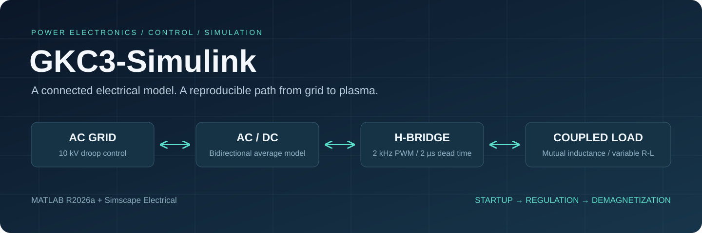

# GKC3-Simulink

**An end-to-end Simulink / Simscape study of a tokamak power supply.**

[中文首页](README.md) · [Getting started](docs/getting-started.md) · [Architecture](docs/architecture.md) · [Technical report](report/README.md)



A 10 kV droop-regulated source, transformer, bidirectional average-value AC/DC interface, switching H-bridge and magnetically coupled variable load share one physical electrical network. The repository includes startup, current regulation, ramp-down and demagnetization experiments, together with reproducible scripts and exported evidence.

## Run

Requires MATLAB R2026a, Simulink, Simscape and Simscape Electrical. The integrated accelerator-mode run also requires a supported compiler.

```matlab
addpath('Project')
start_project
run_integrated('startup')
export_integrated_materials('startup')
run_integrated('full')
export_integrated_materials('full')
```

Browse exported CSV, PNG and PDF files in `Project/Materials` without running MATLAB. Raw MAT files and editable FIG files can be regenerated with the scripts.

## Recorded results

| Quantity | Value | Window / scope |
| --- | ---: | --- |
| Mean plasma current | 9999.28 A | 6–11 s |
| Observed DC-link voltage | 2187.02–2219.18 V | 10 µs logged samples |
| Net energy returned to AC side | 559.21 kJ | 12.3–30 s |
| Switching dead time | 2 µs | Integrated startup and final observation windows |

These values describe a completed 30 s simulation. They are not hardware measurements or course acceptance thresholds. Power plots use differences of internally integrated energy, rather than products of downsampled switching signals.

## Scope

The AC/DC component is an ideal synchronous, reciprocal average-value interface. It does not model a switching rectifier, PLL or converter losses. The DC buffer and interface ratio are explicit modeling assumptions. Baseline and corrected models are retained separately. See [model assumptions](docs/model-assumptions.md) and [validation](docs/validation.md).

## Contributors

[@Hale-debug](https://github.com/Hale-debug), [@Jerry131131](https://github.com/Jerry131131), [@KiloxGo](https://github.com/KiloxGo), [@qikexiu4K4](https://github.com/qikexiu4K4), [@southever](https://github.com/southever), [@zhyz18zsw060620](https://github.com/zhyz18zsw060620).

[Contributing](CONTRIBUTING.md) · [Third-party notices](THIRD_PARTY_NOTICES.md) · [Public release policy](docs/public-release.md)

## License

[MIT](LICENSE) · Copyright © 2026 GKC3-Simulink contributors. Third-party components retain their respective licenses.
