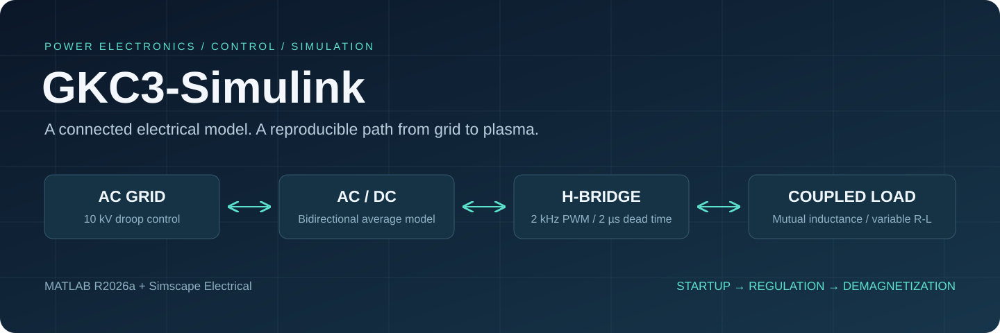
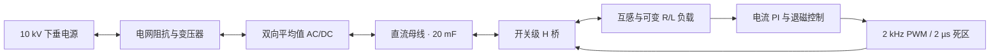
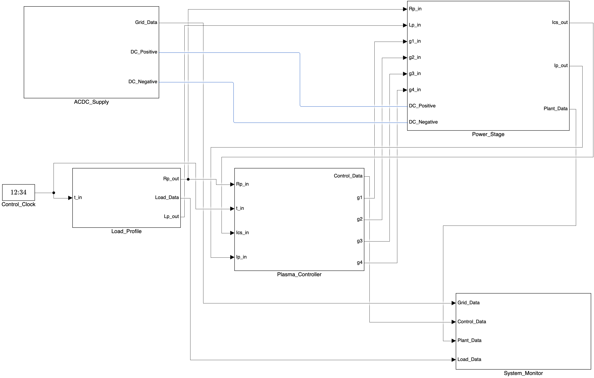
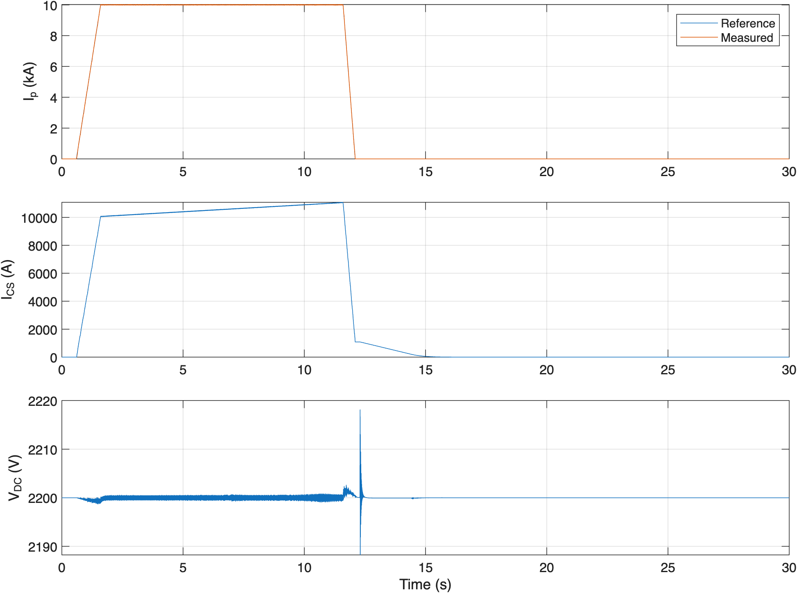
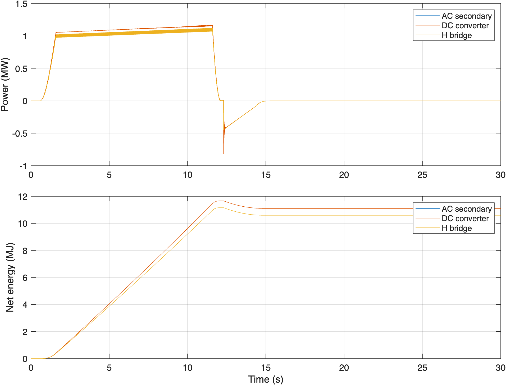
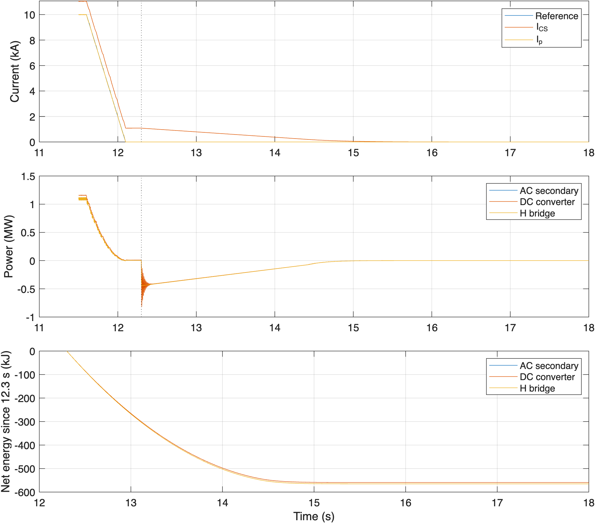

<div align="center">



# GKC3-Simulink

**托卡马克电源系统 · 从交流母线到等离子体负载的联合电气仿真**

[](https://github.com/KiloxGo/GKC3-Simulink/releases/latest)
[](LICENSE)
[](docs/getting-started.md)
[](docs/architecture.md)
[](docs/validation.md)
[](https://github.com/KiloxGo/GKC3-Simulink/actions/workflows/repository-checks.yml)

[快速开始](#快速开始) · [系统架构](docs/architecture.md) · [仿真证据](docs/validation.md) · [技术报告](report/README.md) · [English](README.en.md)

</div>

## 项目概览

GKC3-Simulink 将 10 kV 下垂调压电源、变压器、双向平均值 AC/DC 接口、开关级 H 桥及磁耦合可变负载连接在同一个 Simscape 电气网络中，覆盖启动、电流维持、降流与退磁回馈全过程。

项目同时提供独立模块、参数说明、复现脚本、模型分层视图和可追溯的数值结果，便于学习电源控制、分析能量流动，以及继续开展建模研究。当前定位为教学与研究仿真；平均值接口和已知差异见[模型假设](docs/model-assumptions.md)。

| 联合电气网络 | 开关与控制细节 | 可复现分析 |
| :--- | :--- | :--- |
| 10 kV → 1 kV → 约 2.2 kV DC | 2 kHz PWM、2 µs 死区 | 2 s 启动 / 30 s 全过程 |
| 交流侧双向能量交换 | 电流 PI、前馈、退磁切换 | CSV、PDF、PNG、指标 JSON |
| 动态 R/L 与互感耦合 | 1 µs 求解、10 µs 综合记录 | 脚本生成原始 MAT 与可编辑 FIG |

## 系统架构



<details>
<summary><strong>展开查看实际 Simulink 顶层模型</strong></summary>



</details>

控制器、功率级、电源和观测各自分层；完整内部视图位于 [ModelViews](Project/Materials/Integrated/ModelViews/)。

## 快速开始

**环境：** MATLAB R2026a、Simulink、Simscape、Simscape Electrical。整机脚本使用 accelerator 模式，需要本机支持的编译器。其他 MATLAB 版本尚未验证。

```bash
git clone https://github.com/KiloxGo/GKC3-Simulink.git
cd GKC3-Simulink
```

在 MATLAB 中切换到仓库根目录：

```matlab
addpath('Project')
start_project

% 先运行启动段，再导出结果
run_integrated('startup')
export_integrated_materials('startup')

% 完整启动、维持、降流和退磁过程
run_integrated('full')
export_integrated_materials('full')
```

已有结果可直接浏览，无需先运行 MATLAB。原开发环境中启动段约 45 s、完整过程约 16 min；这是记录的运行耗时，不是性能承诺。首次编译和不同硬件会改变耗时。[详细复现与排错 →](docs/getting-started.md)

## 实测结果

下表来自同一次连续 30 s 联合运行。它们是仿真描述性结果，不是硬件实测或新增验收门限。

| 指标 | 记录结果 | 统计口径 |
| :--- | ---: | :--- |
| 等离子体电流均值 | **9999.28 A** | 6–11 s |
| 直流母线电压范围 | **2187.02–2219.18 V** | 10 µs 记录序列 |
| 向交流侧净回馈能量 | **559.21 kJ** | 12.3–30 s，有符号能量积分 |
| 最终线圈电流 | **−4.21 × 10⁻⁸ A** | 30 s 末值 |
| 门极死区 | **2 µs** | 整机启动及末段观察窗口 |



<table>
<tr>
<td width="50%"></td>
<td width="50%"></td>
</tr>
</table>

功率图的 1 ms 均值由模型内部 **1 µs 能量积分差分**得到，不能用降采样后的开关电压、电流相乘替代。[指标与验证范围 →](docs/validation.md) · [数据字段与口径 →](docs/data.md)

## 模型与实验

| 模型 | 用途 |
| :--- | :--- |
| [`tokamak_integrated.slx`](Project/Models/tokamak_integrated.slx) | 整机联合电气仿真，推荐入口 |
| [`droop_source.slx`](Project/Models/droop_source.slx) | 交流母线下垂调压 |
| [`hbridge_rl_verified.slx`](Project/Variants/hbridge_rl_verified.slx) | 修正浮点时间判断后的 H 桥；0.42 s 全工况死区检查 |
| [`plasma_load.slx`](Project/Models/plasma_load.slx) | 独立可变负载基线，保留原 4 kHz / 10 µs 设置 |
| [`cs_rectifier_average.slx`](Project/Models/cs_rectifier_average.slx) | 独立 1.5 kV、460 s 中央螺线管参考工况 |
| [`hbridge_rl.slx`](Project/Models/hbridge_rl.slx) | 原行为基线，用于比较原死区实现 |
| [`plasma_2khz_detail.slx`](Project/Variants/plasma_2khz_detail.slx) | PWM 敏感性研究；原死区实现会出现 2–3 µs 间隔 |

## 仓库导航

```text
Project/
  Models/          联合模型与独立模块
  Variants/        修正版和对比实验
  Components/      自定义 Simscape 源码与生成库
  Scripts/         仿真、导出和核查入口
  Materials/       已导出的曲线、CSV、模型视图
  Results/         运行摘要；raw/ 在本地生成
report/            脱敏技术报告、LaTeX 源码及插图
docs/              架构、假设、复现、验证和数据说明
tools/             公开文件检查工具
.github/           仓库检查与贡献模板
```

[技术报告与编译说明](report/README.md) · [变更记录](CHANGELOG.md) · [贡献指南](CONTRIBUTING.md)

## 模型边界

- AC/DC 使用理想同步、无损的平均值接口；没有开关级整流器、PLL、滤波器或器件损耗模型。
- 20 mF 母线缓冲和接口变比是明确记录的建模选择。
- 整机用 1 µs 步长解析 2 µs 死区，独立负载基线仍保留 10 µs。
- 原任务提及的部分功率控制接口与当前控制结构存在差异；参数和行为差异见[说明](docs/model-assumptions.md)。
- 本项目不宣称实现完整装置设计、100 MW 系统验证或全部课程要求验收。

## 贡献者

感谢以下六位项目贡献者。账号名单经项目维护者确认，按账号排序展示；不依据历史提交数量分配贡献权重。

| | | |
| :---: | :---: | :---: |
| [@Hale-debug](https://github.com/Hale-debug) | [@Jerry131131](https://github.com/Jerry131131) | [@KiloxGo](https://github.com/KiloxGo) |
| [@qikexiu4K4](https://github.com/qikexiu4K4) | [@southever](https://github.com/southever) | [@zhyz18zsw060620](https://github.com/zhyz18zsw060620) |

[贡献者说明](CONTRIBUTORS.md) · [发布与隐私说明](docs/public-release.md) · [第三方说明](THIRD_PARTY_NOTICES.md)

## License

[MIT](LICENSE) · Copyright © 2026 GKC3-Simulink contributors. Third-party components retain their respective licenses.
