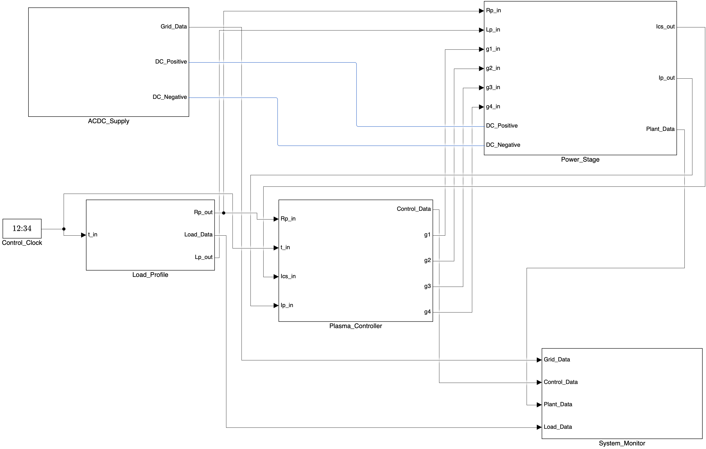

# 系统架构

联合模型入口为 `Project/Models/tokamak_integrated.slx`。电源、整流接口、直流侧及负载位于同一电气网络，允许退磁能量回流到交流侧。

| 层级 | 职责 | 关键接口 |
| --- | --- | --- |
| ACDC_Supply | 下垂调压、三相电网、变压器、平均值接口、母线缓冲 | DC_Positive / DC_Negative，Grid_Data |
| Load_Profile | 电阻、电感随时间变化 | Rp_out、Lp_out |
| Plasma_Controller | 电流参考、PI、前馈、退磁、PWM 与死区 | Ics、Ip 反馈；四路门极 |
| Power_Stage | H 桥、测量、互感、可变 R/L | 直流端、门极、负载反馈 |
| System_Monitor | 信号合并、桥侧功率、能量积分与记录 | joint 的 19 个观测通道 |

## 运行时序

| 时段 | 行为 |
| --- | --- |
| 0–0.6 s | 启动前阶段 |
| 0.6–1.6 s | 电流指令上升 |
| 1.6–11.6 s | 维持阶段 |
| 11.6–12.1 s | 电流指令降至零 |
| 12.3–30 s | 退磁与能量回馈 |

这些时序来自原任务设置；公开版没有新增评价阈值。AC/DC 方程、母线缓冲与仿真步长见[模型假设](model-assumptions.md)。独立 460 s CS 模型是另一个参考工况，不能把它的能量或额定值直接代入 30 s 联合运行。
